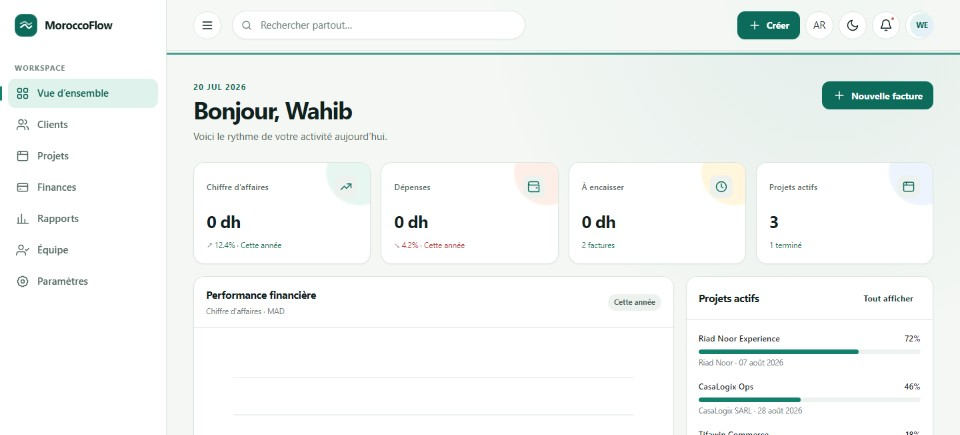

<!-- Generated from README.tpl.md by scripts/render_readme.py.
     Edits here are overwritten on the next scheduled run. -->

  

  
  
  
  

<h3 align="center">I build full-stack products, and I fix bugs in the open-source tools developers depend on.</h3>

<table>
  <tr>
    <td align="center" valign="top" width="170"><h3>17</h3>pull requests merged by other maintainers</td>
    <td align="center" valign="top" width="170"><h3>28</h3>repositories contributed to that I don't own</td>
    <td align="center" valign="top" width="170"><h3>419</h3>public commits</td>
    <td align="center" valign="top" width="170"><h3>7</h3>public projects</td>
  </tr>
</table>

## 🚀 What I've built

<table>
  <tr>
    <td width="50%" valign="top">
      
      <h3><a href="https://github.com/WAHIB-EL-KHADIRI/movieverse">MovieVerse</a></h3>
      Movie discovery app on the TMDB API: trending, search, filters, detail pages, favorites, dark mode and skeleton loaders.
        
      React · TypeScript · React Router
        
      🎬 <a href="https://film2027.netlify.app"><b>Try the live demo</b></a>
    </td>
    <td width="50%" valign="top">
      
      <h3><a href="https://github.com/WAHIB-EL-KHADIRI/MoroccoFlow">MoroccoFlow</a></h3>
      Bilingual FR/AR business platform for Moroccan SMEs: CRM, quotes, invoices and expenses in MAD, with real RTL support.
        
      Fastify · PostgreSQL row-level security · offline-first PWA
        
      🧾 <a href="https://wahib-el-khadiri.github.io/MoroccoFlow/"><b>Try the live demo</b></a>
    </td>
  </tr>
</table>

| Project | What it does | Built with |
|---|---|---|
| **[AgentOS](https://github.com/WAHIB-EL-KHADIRI/AgentOS)** | Runtime for AI agents: journals every LLM exchange and tool result, so a run can be replayed offline. Alpha. | Rust |
| **[autofix-safety](https://github.com/WAHIB-EL-KHADIRI/autofix-safety)** | Checks that a linter's `--fix` doesn't break your code. Found data-loss bugs in sqlfluff, found nothing in ruff, and reports both. | Python |
| **[TaskFlow Pro](https://github.com/WAHIB-EL-KHADIRI/taskflow-pro)** | Task and project management system on a custom MVC. | PHP 8.1 |

## 🏆 Merged into projects developers rely on

| Project | ⭐ | What I fixed |
|---|---|---|
| **[Prefect](https://github.com/PrefectHQ/prefect)** | 24k+ | Stopped the release ref being expanded into shell in the jobs that publish to PyPI ([#22882](https://github.com/PrefectHQ/prefect/pull/22882)) |
| **[OpenSRE](https://github.com/Tracer-Cloud/opensre)** | 12k+ | CLI config-precedence bug, so `OPENSRE_INTERACTIVE` and `config.yml` are honored ([#4387](https://github.com/Tracer-Cloud/opensre/pull/4387)) |
| **[sktime](https://github.com/sktime/sktime)** | 10k+ | Removed mutable default arguments from the ConvTimeNet backbones ([#10730](https://github.com/sktime/sktime/pull/10730)) |
| **[SQLFluff](https://github.com/sqlfluff/sqlfluff)** | 10k+ | Release workflow: the version input no longer reaches a command substitution ([#8375](https://github.com/sqlfluff/sqlfluff/pull/8375)) |
| **[MCP Rust SDK](https://github.com/modelcontextprotocol/rust-sdk)** | 4k+ | An empty `cacheScope` no longer silently drops the whole result ([#1281](https://github.com/modelcontextprotocol/rust-sdk/pull/1281)) |
| **[RustSec](https://github.com/rustsec/rustsec)** | 1.9k+ | Documented that `cargo audit` isn't safe to run on untrusted projects ([#1714](https://github.com/rustsec/rustsec/pull/1714)) |

<b>11 more merged pull requests</b>

 

- **[toqito](https://github.com/vprusso/toqito)**: built depolarizing Kraus operators without a nested loop ([#1921](https://github.com/vprusso/toqito/pull/1921))
- **[PyScrappy](https://github.com/mldsveda/PyScrappy)**: aligned the GitHub scraper's default result count with the MCP tool ([#82](https://github.com/mldsveda/PyScrappy/pull/82))
- **[instrumation](https://github.com/abduznik/instrumation)**: handled empty or `None` input in the duplicate-address scanner ([#137](https://github.com/abduznik/instrumation/pull/137))
- **[myskoda](https://github.com/skodaconnect/myskoda)**: added missing `SoftwareStatus` members ([#641](https://github.com/skodaconnect/myskoda/pull/641))
- **[opendot](https://github.com/vedaant00/opendot)**: `grep` no longer crashes outside the workspace, and `list_files` honors the ignore set ([#73](https://github.com/vedaant00/opendot/pull/73), [#61](https://github.com/vedaant00/opendot/pull/61))
- **[thingctx](https://github.com/thingctx/thingctx)**: pinned the remaining GitHub Actions to commit SHAs ([#127](https://github.com/thingctx/thingctx/pull/127))
- **[Citadel](https://github.com/masumi-network/Citadel)**: removed a dead re-export facade and added test coverage ([#130](https://github.com/masumi-network/Citadel/pull/130), [#131](https://github.com/masumi-network/Citadel/pull/131))
- **[composable-data-stack](https://github.com/RonaldHensbergen/composable-data-stack)**: removed an unreachable credential branch and fixed a docs mapping ([#344](https://github.com/RonaldHensbergen/composable-data-stack/pull/344), [#345](https://github.com/RonaldHensbergen/composable-data-stack/pull/345))

## 🛠️ Stack

  
  
  
  
  
  
  
  
  
  
  
  
  

## ✍️ Writing

- [I Round-Tripped 2,249 Test Fixtures Through sqlfluff's Auto-Fixer. Eight Came Back Unparsable.](https://dev.to/wahib_el_khadiri_0/i-round-tripped-2249-test-fixtures-through-sqlfluffs-auto-fixer-eight-came-back-unparsable-45le)
- [I Read 25 Release Pipelines Looking for One Bug. Four Had It.](https://dev.to/wahib_el_khadiri_0/i-read-25-release-pipelines-looking-for-one-bug-four-had-it-3n9e)
- [A GitHub Actions tag is a promise, not a fact: pinning by SHA the right way](https://dev.to/wahib_el_khadiri_0/a-github-actions-tag-is-a-promise-not-a-fact-pinning-by-sha-the-right-way-3np)

## 📺 YouTube

**[WAHIB_DEVELOPPEUR_MAROC](https://youtube.com/@DEVELOPPEUR_MAROC)** — دروس برمجة بالدارجة (HTML ← CSS ← JavaScript…)

---

<h3 align="center">Hiring a junior full-stack developer? Let's talk.</h3>

  <a href="https://wahib-portfolio.netlify.app"><b>Portfolio</b></a> ·
  <a href="https://www.linkedin.com/in/wahib-el-khadiri"><b>LinkedIn</b></a>

  <b>41</b> pull requests into repositories I don't own:
  <b>17</b> merged · <b>10</b> open · <b>14</b> closed 
  <b>419</b> commits · <b>25</b> issues · <b>13</b> stars across <b>7</b> projects 
  Public contributions, counted 2026-11-13 by
  <a href="https://github.com/WAHIB-EL-KHADIRI/WAHIB-EL-KHADIRI/actions/workflows/readme.yml">a daily Action</a>

